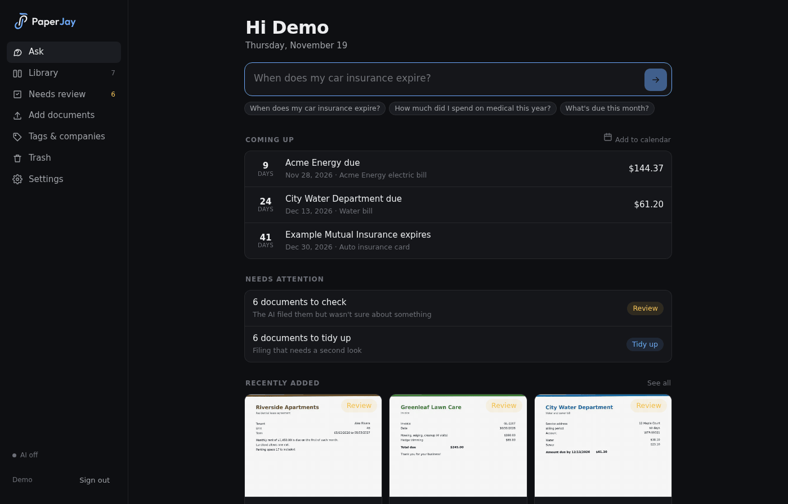
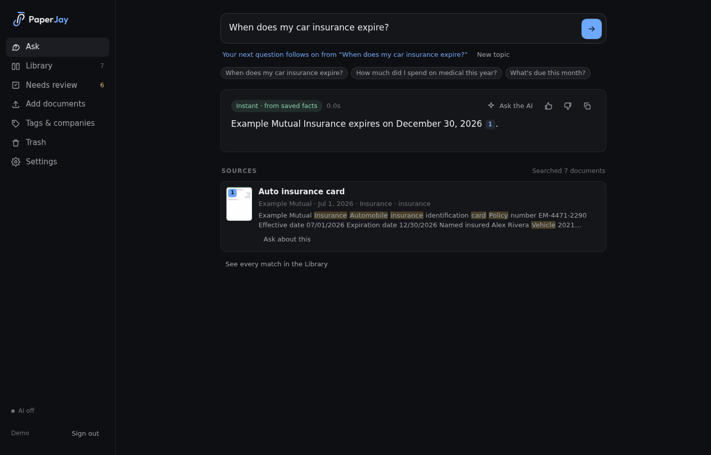
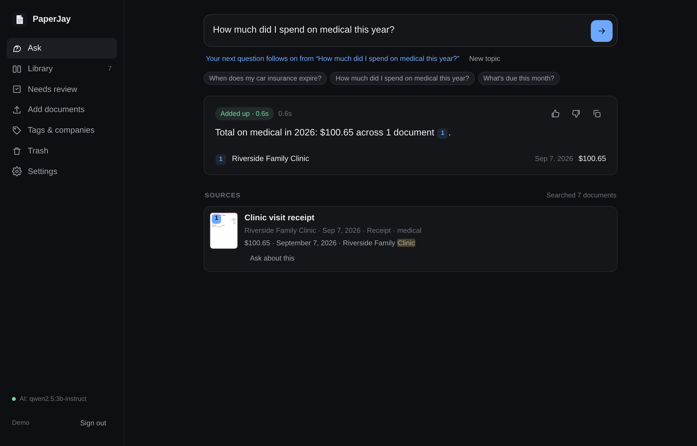
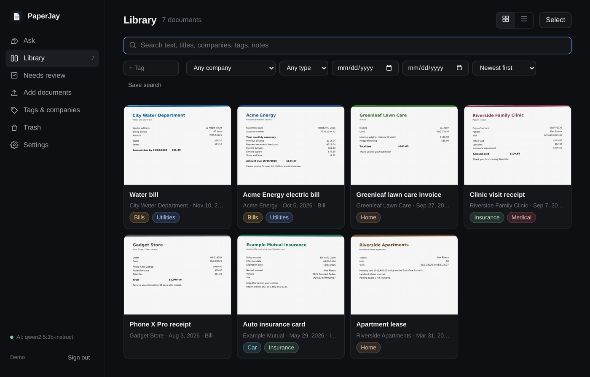
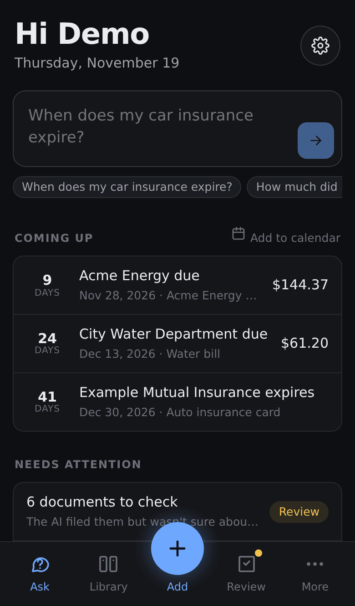
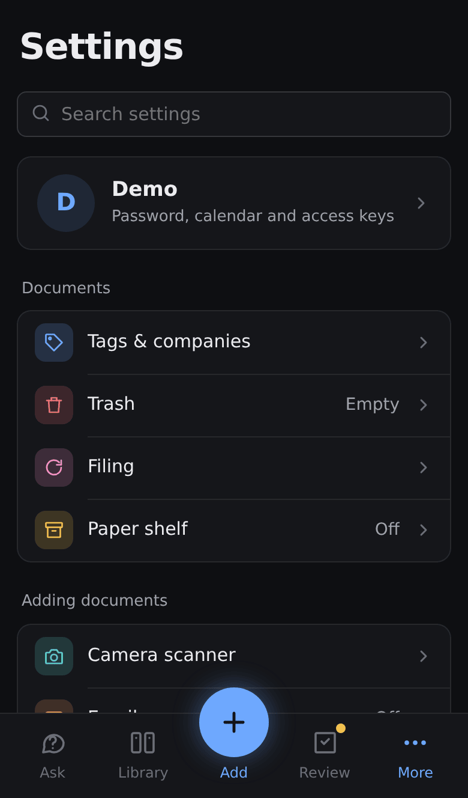
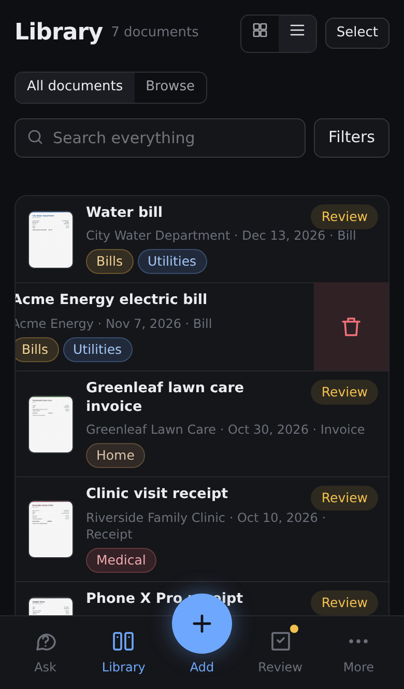
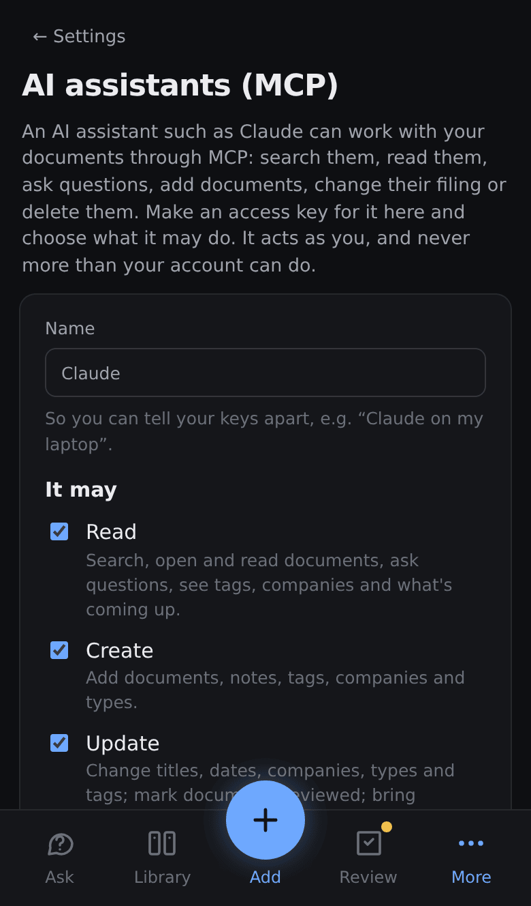

# PaperJay

**File your documents, then ask them questions.**

PaperJay is a self-hosted home for your paperwork. Photograph a bill, drop in a PDF, forward a scan: PaperJay
reads it with OCR, files it (title, date, company, type, tags) and lets you find it again, or just ask:
*"When does my car insurance expire?"*, *"How much did we spend on medical this year?"*. Answers cite the
documents they came from, and every number in them is checked against those documents. AI is optional and
runs on your own hardware.



| Ask | Totals | Library |
|---|---|---|
|  |  |  |

**On a phone** (it installs as an app):

| Start page | Settings | Swipe to delete | AI assistants |
|---|---|---|---|
|  |  |  |  |

*Screenshots use made-up documents. The answers shown need no AI.*

## What it does

- **Reads everything.** PDFs, phone photos (HEIC too), scans and multi-page TIFFs, through
  [OCRmyPDF](https://ocrmypdf.readthedocs.io/) and Tesseract: pages are turned upright, straightened and made
  into a searchable PDF/A. Your original file is kept byte for byte.
- **Files it for you** (with AI): title, date, company, document type and tags, read from the text. It never
  changes anything a person has set, only uses tags the text supports, and puts anything uncertain in
  **Needs review**.
- **Shows what's left to tidy**: documents with no company, date or type, file-name titles, possible copies
  and filing the text and the AI disagree on, each with a one-tap fix. Every fix is your own filing, so the
  next documents from that company are filed the same way.
- **Answers questions** with citations. Many need no AI at all: *show me…* lists, totals added up in code,
  and single facts (*"my policy number?"*) from what was read when the document arrived. If a word appears
  in no document, it says so instead of guessing. The same box finds things: as you type it
  suggests matching companies, people, numbers and documents.
- **Scans with your phone's camera**: the page is outlined live and the photo taken when you hold still,
  page after page, then cut out, straightened and cleaned up into one PDF.
- **Collects emailed documents**: checks your mailboxes every night and adds the PDFs and photos attached
  to bills and statements (filters by sender and subject).
- **Works with AI assistants**: a built-in MCP server lets Claude (or another assistant) search, read, add,
  change and delete documents, with an access key that has only the permissions you choose
  ([docs/mcp.md](docs/mcp.md)).
- **Feels at home on a phone**: install it from the browser; a tab bar with a big **Add** button, swipe a
  document left to delete it, share files to PaperJay, scan with the camera.
- **Makes a tax pack**: everything for one tax year in one zip, a folder per category and a spreadsheet of
  the amounts, for your accountant ([docs/tax-pack.md](docs/tax-pack.md)). Any Library list downloads as a
  spreadsheet too.
- **Tells you what paper can go**: keep rules per kind of paper (tax papers seven years, bank statements one…),
  and a list of the papers on your shelf you can shred now ([docs/keeping-paper.md](docs/keeping-paper.md)).
- **Remembers dates**: bills coming due and policies expiring, on the start page, in your phone's calendar,
  and as JSON for Home Assistant.
- **Gets out of your way**: one container, one data folder (SQLite, no Postgres or Redis), a plain-folder
  export you can open without PaperJay, an importer from Paperless-ngx, household accounts, an installable
  phone app, dark and light themes.

## Install

**Docker** (any Linux, NAS, Raspberry Pi 4/5):

```sh
mkdir paperjay && cd paperjay
curl -fsSLO https://raw.githubusercontent.com/3g15h1/paperjay/main/docker-compose.yml
docker compose up -d          # then open http://<this machine>:8000
```

**Proxmox VE**: run on the host, as root:

```sh
bash -c "$(curl -fsSL https://raw.githubusercontent.com/3g15h1/paperjay/main/install.sh)"
```

It creates a small Debian container and prints its address; run it again to upgrade. The first visit opens a
short setup. More, including a manual install: [docs/install.md](docs/install.md).

**What it needs:** 2 CPU cores and 2 GB of memory without AI. A 12-megapixel phone photo takes about 10 s to
read. For AI, add a local model server: [docs/ai-models.md](docs/ai-models.md) (4+ cores and 8 GB for the
default model on a CPU; a GPU makes it fast).

## Guides

- [Installing](docs/install.md) · [Choosing an AI model](docs/ai-models.md) · [Backups](docs/backups.md)
- [Moving from Paperless-ngx](docs/migrate-from-paperless.md) · [Phones: camera, share sheet, shortcuts, calendar](docs/phone.md) · [Email](docs/email.md)
- [The tax pack](docs/tax-pack.md) · [Keeping and shredding paper](docs/keeping-paper.md) · [AI assistants (MCP)](docs/mcp.md) · [Home Assistant](docs/home-assistant.md) · [Export format](docs/export.md) · [API](docs/api.md)

## How it compares

| | PaperJay | Paperless-ngx | Paperless-ngx + paperless-ai / paperless-gpt |
|---|---|---|---|
| OCR | OCRmyPDF + Tesseract | OCRmyPDF + Tesseract | Paperless's, or an LLM's (paperless-gpt) |
| Runs as | one app, SQLite | web app + worker, Postgres/MariaDB (or SQLite) + Redis | Paperless plus another app |
| AI filing | optional, local; grounded in the text, never overrides people | rule-based matching, optional AI suggestions | the add-on's job |
| Questions with cited, checked answers | yes, plus totals and instant facts | no | chat (paperless-ai) |
| Due and expiry dates, calendar feed | yes | no | no |
| Mail import | yes | yes | via Paperless |
| Works with AI assistants (MCP), with per-key permissions | built in | not built in (community add-ons) | not built in |
| Workflows, barcode splitting, custom fields, per-document permissions | not yet | **yes** | via Paperless |

Paperless-ngx is the mature, feature-rich choice for large or shared archives with complex rules. PaperJay
aims at households: fewer moving parts, filing that mostly happens by itself, and answers instead of
searches. You can move from Paperless-ngx without losing anything, and leave PaperJay just as easily.

## Your data

Everything stays on your server. The AI, if you use one, is a server you choose; with a local one, no
document text leaves your network. `paperjay export <folder>` writes all originals, searchable PDFs and a
`manifest.json` of the filing into ordinary folders, and only copies what changed on later runs.

Keep PaperJay on your home network. To reach it from outside, use a VPN (e.g. Tailscale or WireGuard) or a
reverse proxy with HTTPS. Security reports: [SECURITY.md](SECURITY.md).

## Development

```sh
python3 -m venv .venv && .venv/bin/pip install -e '.[test]'
.venv/bin/pytest -q                                   # needs tesseract-ocr, ghostscript, unpaper, poppler-utils
python scripts/demo.py ./demo-data && DATA_DIR=./demo-data .venv/bin/paperjay serve   # sign in: demo / demo-password
```

Plain Python (FastAPI) and plain JavaScript modules: no build step. The [CHANGELOG](CHANGELOG.md) lists
every release.

## License

[AGPL-3.0](LICENSE). Use, change and share PaperJay freely; if you offer a changed version to others over a
network, share your changes too.
